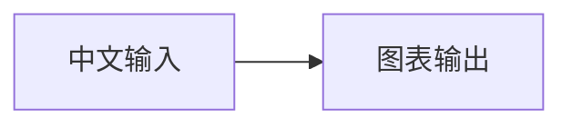

# 参数与输入格式

## 命令

```text
node scripts/render.mjs <html|markdown|mermaid|echarts>
  --input <文件|URL|->
  --output <文件>
```

`--input -` 从 stdin 读取。URL 输入会先作为文本下载（HTML 网页直接由浏览器打开）。输出目录不存在时自动创建。

## 通用参数

| 参数 | 默认值 | 说明 |
|---|---:|---|
| `--width` | HTML/Markdown 1440；图表 1200 | 桌面视口或图表宽度，200–10000px |
| `--height` | HTML/Markdown 900；图表 675 | 桌面视口或图表高度，200–10000px |
| `--selector` | 无 | HTML 中唯一匹配的可见元素；只支持 PNG/JPEG |
| `--full-page` | HTML/Markdown PNG 默认启用 | 截取全部文档，最大高度 30000px |
| `--wait-selector` | 无 | 输出前等待该选择器至少一个元素可见 |
| `--wait-ms` | 500 | 常规加载完成后的额外稳定时间，0–30000ms |
| `--timeout` | 30000 | 导航、ready 标志和选择器的总等待上限 |
| `--paper` | A4 | PDF 纸型：A3、A4、A5、Letter、Legal、Tabloid |
| `--landscape` | false | 横向 PDF |
| `--theme` | light | `light` 或 `dark` |
| `--strict` | false | 请求失败、HTTP 4xx/5xx 或 console error 也视为失败 |
| `--keep-animations` | false | 保留动画；默认让截图进入稳定的最终状态 |

HTML/Markdown 输出支持 `.png`、`.jpg`、`.jpeg`、`.pdf`；Mermaid/ECharts 支持 `.png`、`.svg`、`.pdf`。

## Ready 协议

复杂页面应在任何异步工作之前声明未完成，所有图表、字体请求或数据请求完成后再置为完成：

```html
<html data-render-ready="false">
<script>
  Promise.all([loadData(), renderCharts()]).then(() => {
    document.documentElement.dataset.renderReady = "true";
  });
</script>
```

也可以使用：

```js
window.__RENDER_READY__ = false;
// 完成后：
window.__RENDER_READY__ = true;
```

不要等到异步任务结束时才首次创建该变量；渲染器在页面加载后找不到标志时会采用通用稳定检测。

## Markdown 图表

普通 GFM Markdown 可包含表格、代码、图片、原始 HTML 和分页元素：

```html
<div class="page-break"></div>
```

Mermaid fenced block：

````markdown

````

ECharts fenced block必须是严格 JSON：

````markdown
```echarts
{
  "title": {"text": "季度收入"},
  "xAxis": {"type": "category", "data": ["一季度", "二季度"]},
  "yAxis": {"type": "value"},
  "series": [{"type": "bar", "data": [120, 180]}]
}
```
````

需要 JavaScript formatter、事件或多个联动图表时，改为完整 HTML。

## 截取网页图表

`--selector '#chart'` 使用 Chromium 的元素截图，适用于 ECharts、D3、Mermaid、Plotly、Cytoscape、vis-network，以及 Canvas、SVG、WebGL 和普通 DOM 内容。

- 选择器匹配 0 个或多个元素都会失败。
- 元素必须有非零可见边界；图表容器必须设置明确宽高。
- 挂载到 `body` 的 tooltip、下拉框或弹层不属于图表元素边界。选择共同父容器，或使用整页截图。
- WebGL 截图依赖镜像保留 GPU/WebGL 软件实现；不要额外传入 `--disable-gpu`。
- 对 `local-web-resources` 页面，先确保 HTML 内的资源地址可由容器访问。

## 退出与摘要

成功时 stdout 输出单行 JSON，包含输入、输出、格式、尺寸、耗时和资源警告数量。警告写入 stderr。

以下情况返回非零状态：参数或 JSON 无效、导航失败、页面未捕获脚本异常、ready 超时、选择器不唯一或不可见、输出失败，以及 `--strict` 下的资源或 console error。
